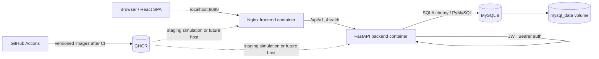

# Architecture

The diagram shows the local Compose stack and the intended delivery path. GHCR publication and a real host deployment must be verified separately.

## Request and data flow

1. Vite builds static React assets. The unprivileged Nginx container serves them on container port 8080, published only as `127.0.0.1:8080` on the host. It proxies `/api/` and `/health` to `backend:8000`.
2. FastAPI validates requests with Pydantic and exposes versioned routes under `/api/v1`. Passwords are hashed; login returns a short-lived JWT. Authenticated routes identify the user from the Bearer token.
3. Project and task queries include owner checks. For another user's resource, the API returns 404 to avoid confirming that it exists. Dashboard aggregates use the same owner scope.
4. SQLAlchemy accesses MySQL over the internal Compose network. `backend/entrypoint.sh` applies Alembic migrations before Uvicorn starts. MySQL is never published to the host; its `mysql_data` named volume survives ordinary `docker compose down`.

## Boundaries and dependencies

- `taskflow-internal` carries app-to-database traffic and is marked internal; frontend and backend also share `taskflow-edge`. The browser cannot contact MySQL directly.
- Backend and frontend containers run as non-root users. Health checks and `depends_on: condition: service_healthy` order startup, but do not replace monitoring.
- The API is also published on `127.0.0.1:8001` for local Swagger and diagnostics. Both published ports are loopback-only; a Linux deployment plan uses host Nginx for public HTTPS.
- `.env` stays outside Git. CORS allows one configured origin. The Docker UI uses same-origin API calls; Vite development usually uses `http://localhost:5173`.
- Pytest uses SQLite fixtures for API behavior tests; the CI backend job separately runs Alembic migrations against a MySQL 8 service. See [TESTING.md](TESTING.md).

## Code map

| Path | Role |
| --- | --- |
| `backend/app/api/routes/` | Authentication, project, task, and dashboard HTTP endpoints. |
| `backend/app/models/`, `backend/alembic/` | ORM tables and schema migration. |
| `backend/app/core/` | Configuration, JWT/password helpers, logging. |
| `backend/tests/` | Unit, API, authorization, and validation tests. |
| `frontend/src/` | React routes, auth state, API calls, UI and styles. |
| `frontend/nginx.conf` | Static SPA serving and same-origin API proxy. |
| `.github/workflows/` | CI, gated GHCR release, runner-only staging simulation. |

## Trade-offs

Single-host Compose is simple to understand and demo but has one failure domain. Database backups, observability, rate limiting, and an operational rollback procedure need work before real use. See [SECURITY.md](SECURITY.md) and [CLOUD_DEPLOYMENT.md](CLOUD_DEPLOYMENT.md).
