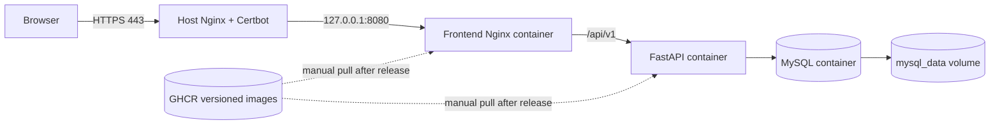

# Cloud deployment plan (not yet performed)

This is a single Ubuntu-server plan, not a deployed environment. Use a domain you control, a supported Ubuntu LTS host, and a server size that can run MySQL plus two containers. The existing Compose file binds web/API ports to `127.0.0.1` and does not publish MySQL. Host Nginx exposes only HTTPS; it proxies to the frontend on loopback.



## 1. Secure and prepare the host

1. Create a non-root administrative account with an SSH public key. Confirm a **second** key-based SSH session works before changing SSH authentication. Then use a dedicated SSH config drop-in such as `/etc/ssh/sshd_config.d/99-taskflow.conf`:

   ```text
   PermitRootLogin no
   PasswordAuthentication no
   KbdInteractiveAuthentication no
   ```

   Check effective settings with `sudo sshd -T`, validate syntax with `sudo sshd -t`, and only then reload SSH. Keep the existing SSH session and the cloud provider's console/recovery path available until another login succeeds.
2. Patch the OS. Configure automatic security updates and a regular maintenance window. Install Nginx and `ufw` from Ubuntu packages.
3. Allow SSH **before** enabling UFW. Restrict SSH to your own public IP when possible; allow 80/tcp and 443/tcp for web traffic. For example, on the server:

   ```bash
   sudo ufw default deny incoming
   sudo ufw allow OpenSSH
   sudo ufw allow 80/tcp
   sudo ufw allow 443/tcp
   sudo ufw enable
   sudo ufw status verbose
   ```

   Check the provider's security group/firewall too. Docker-published ports can bypass UFW; therefore retain the Compose `127.0.0.1` bindings and verify externally that 8080, 8001, and 3306 are closed. [Ubuntu UFW guidance](https://documentation.ubuntu.com/server/how-to/security/firewalls/index.html); [Docker firewall warning](https://docs.docker.com/engine/install/ubuntu/).

4. Install Docker Engine plus the Compose plugin from Docker's **official Ubuntu apt repository**, following the current [Docker instructions](https://docs.docker.com/engine/install/ubuntu/). Verify `sudo docker version` and `sudo docker compose version`. Do not add the deploy account to the `docker` group just for convenience; it grants root-equivalent control.

## 2. DNS, code, configuration, and images

Create an `A` record from `tasks.example.com` to the server's public IPv4 address. Add an `AAAA` record only if IPv6 is configured and reachable. Wait for DNS propagation and verify both records before requesting a certificate.

Clone the repository under a controlled directory such as `/opt/taskflow`, then check out the **same release tag** whose images you will pull. The following are examples, not commands already executed:

```bash
cd /opt/taskflow
git fetch --tags
git switch --detach v1.0.0
cp .env.example .env
chmod 600 .env
```

Edit `.env` locally, never in Git or a ticket. Replace all example passwords and `JWT_SECRET_KEY` with independent random values. Set `FRONTEND_ORIGIN=https://tasks.example.com`; leave `DB_HOST=db`. Add these image references to `.env` (use your actual lowercase GHCR owner and released tag):

```dotenv
TASKFLOW_BACKEND_IMAGE=ghcr.io/your-github-user/taskflow-backend:v1.0.0
TASKFLOW_FRONTEND_IMAGE=ghcr.io/your-github-user/taskflow-frontend:v1.0.0
```

The image override in `docker-compose.staging.yml` is also usable for this manual pull path. For public GHCR packages, `docker compose pull` needs no credentials. If packages are private, use a narrowly scoped `read:packages` token via `docker login ghcr.io --password-stdin` in a trusted interactive session; do not put the token in `.env`, shell history, or this repo. GitHub documents package visibility and authentication [here](https://docs.github.com/en/packages/working-with-a-github-packages-registry/working-with-the-container-registry).

```bash
sudo docker compose -f docker-compose.yml -f docker-compose.staging.yml config --quiet
sudo docker compose -f docker-compose.yml -f docker-compose.staging.yml pull backend frontend db
sudo docker compose -f docker-compose.yml -f docker-compose.staging.yml up -d --no-build --wait
sudo docker compose -f docker-compose.yml -f docker-compose.staging.yml ps
curl --fail http://127.0.0.1:8080/health
```

The backend entrypoint applies migrations before it reports healthy. `up --wait` must complete before enabling public traffic. `docker compose down` preserves the database volume; `down -v` destroys it.

## 3. Reverse proxy and TLS

Install host Nginx (`sudo apt install nginx`). Use a site file under `/etc/nginx/sites-available/` with your real domain; enable it under `sites-enabled/`. A minimal HTTP config, before Certbot adds TLS, is:

```nginx
server {
    listen 80;
    listen [::]:80;
    server_name tasks.example.com;

    location / {
        proxy_pass http://127.0.0.1:8080;
        proxy_set_header Host $host;
        proxy_set_header X-Real-IP $remote_addr;
        proxy_set_header X-Forwarded-For $proxy_add_x_forwarded_for;
        proxy_set_header X-Forwarded-Proto $scheme;
    }
}
```

Run `sudo nginx -t` before `sudo systemctl reload nginx`. The frontend container routes `/api/` to the backend, so the host proxy needs only the frontend upstream. Swagger is intentionally **not** public in this example; reach `127.0.0.1:8001/docs` through an SSH tunnel if needed.

Once DNS and port 80 work, follow [Certbot's current Nginx instructions](https://certbot.eff.org/instructions?os=snap&ws=nginx): install the supported Certbot package, run `sudo certbot --nginx -d tasks.example.com`, and test renewal with `sudo certbot renew --dry-run`. Confirm HTTPS redirect and certificate in a browser. Do not close port 80 if using HTTP-based renewal. Validate `curl --fail https://tasks.example.com/health` and run `bash scripts/smoke_test.sh https://tasks.example.com`; the smoke test writes a test account/project/task to the server database.

## 4. Updates, rollback, and troubleshooting

The intended flow is PR checks on `develop`, a reviewed `vX.Y.Z` tag, the gated GHCR release workflow, optional runner-only staging simulation, and **manual** host image update. There is no automated deployment to the host. Before an update, take and test an off-host MySQL backup. Change both `TASKFLOW_*_IMAGE` values in `.env` to the new tag, check out the matching source tag, pull, and run the same `up -d --no-build --wait` command. Run the health and smoke checks before announcing success.

For a faulty release, stop traffic if necessary, use `git revert` on the code branch to make a corrective commit, and redeploy the previous known-good image tag by restoring both image references and matching Compose source tag. **Database rollback is not automatic:** Alembic upgrades may be incompatible with older images. Check migration compatibility before reverting images; restore a tested backup only with an explicit recovery plan. Do not delete the volume to attempt a rollback.

Troubleshooting commands:

```bash
sudo docker compose -f docker-compose.yml -f docker-compose.staging.yml ps
sudo docker compose -f docker-compose.yml -f docker-compose.staging.yml logs --tail=100 backend
sudo docker compose -f docker-compose.yml -f docker-compose.staging.yml logs --tail=100 db
curl -i http://127.0.0.1:8080/health
sudo nginx -t
sudo ufw status verbose
```

If `/health` is 503, inspect MySQL health, credentials, and migrations. If the SPA loads but requests fail, check the API response, Nginx proxy, and exact `FRONTEND_ORIGIN`. If HTTPS fails, check DNS, ports 80/443, Nginx syntax, certificate renewal, and provider firewall. Never paste `.env`, tokens, or full sensitive logs into public issues.

This plan does not provide backups, monitoring, rate limiting, high availability, or operational support by itself; those are prerequisites for real production use.
